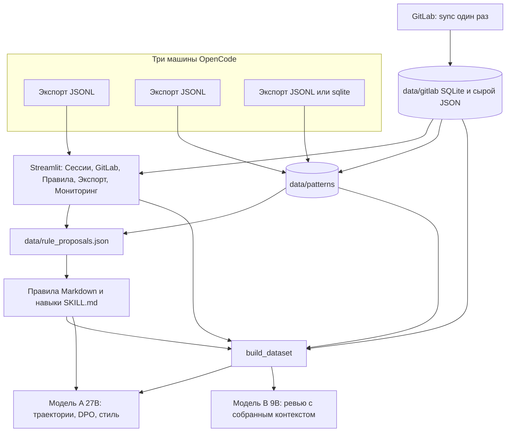

# finetune-curator

Пайплайн собирает историю работы агента и ревью в GitLab в два набора для дообучения и в правила, которыми агент пользуется сразу.

Две модели:

- **Модель A, автор кода, около 27B.** Базовый чекпоинт `Qwen/Qwen3.5-27B`. Учится на успешных траекториях OpenCode, на парах DPO из правок пользователя и на стиле проекта: полировка тимлида и правки после комментария ревьюера. В системный промпт и в `.opencode/skills` рядом с ней кладутся одобренные правила и навыки.
- **Модель B, ревьюер, около 9B.** Кандидаты: `Qwen/Qwen3.5-9B` (значение по умолчанию) и `deepreinforce-ai/Ornith-1.0-9B` (MIT). Сейчас это этап 1: модель видит уже собранный контекст (дифф, описание MR, связанные задачи, код на базовом коммите, определения символов, одобренные правила) и пишет комментарий. Агентное ревью с инструментами только на чтение — отдельная будущая задача и в этом репозитории не реализовано.

Правила и навыки — третий результат, не третья модель. Правило — короткая императивная инструкция для системного промпта или `AGENTS.md`. Навык — пошаговый сценарий под один тип задачи в формате OpenCode `SKILL.md`. Оба живут в одном файле предложений и проходят одну страницу одобрения.

Оценка качества LogMiner — структурный фильтр, а не метка «сессия удалась». Решения Keep и одобренные правила стоит просматривать глазами.

## Содержание

1. [Цели](#цели)
2. [Архитектура](#архитектура)
3. [Установка](#установка)
4. [Конфигурация](#конфигурация)
5. [Порядок работы](#порядок-работы)
6. [Форматы данных](#форматы-данных)
7. [Приватность](#приватность)
8. [Устранение неполадок](#устранение-неполадок)
9. [Частые вопросы](#частые-вопросы)
10. [Каталог файлов](#каталог-файлов)
11. [Тесты](#тесты)

## Цели

| Результат | Откуда берётся | Куда кладётся |
| --- | --- | --- |
| Модель A, 27B | Удачные сессии OpenCode, правки пользователя, стиль тимлида и правки после комментария | `data/finetune/` или отдельный каталог `--task author` |
| Модель B, 9B | Комментарии всех ревьюеров и негативные примеры «замечаний нет» | `--task review`, бюджет по умолчанию 8192 токена |
| Правила | Ошибки сессий, кластеры на трёх и более типах задач, комментарии GitLab | `AGENTS.md` / системный промпт |
| Навыки | Кластеры, которые не тянут на общее правило | `.opencode/skills/<id>/SKILL.md` |

Локальная машина, под которую написаны профили: две RTX 5060 Ti 16GB (Blackwell, `sm_120`, без NVLink), i9-9900K, 80 ГБ RAM. Ревьюер 9B на ней обучается. Автор 27B в bf16 — только на арендованной A100 или H100 80 ГБ. Домашний профиль 27B — это 4-bit QLoRA на коротких примерах, с обязательным сравнением с базовой моделью.

## Архитектура

Один процесс Streamlit (`streamlit run viewer/app.py`) и один файл предложений. Отдельного второго пайплайна для правил нет. Режим «предложение с одной сессии» (`mode: per-session`) — частный случай: кластер размера 1 или отладка. Корпусный `recommend` пишет в тот же `data/rule_proposals.json` и заменяет такие черновики.



Границы модулей:

| Каталог | Что делает |
| --- | --- |
| `scripts/ingest/` | Сессии OpenCode, общий каталог элементов, клиент и офлайн-хранилище GitLab |
| `scripts/llm/` | Общий клиент OpenAI-совместимого API, адрес сервера, разбор JSON |
| `scripts/analysis/` | Импорт нескольких машин, аннотация, кластеры, рекомендации, мониторинг |
| `scripts/proposals/` | Один файл предложений, одобрение, экспорт правил и навыков |
| `scripts/datasets/` | Задачи agentic / style / review, шаблоны чата, длины, упаковка контекста ревью |
| `scripts/training/` | Целевые модели, метрики на отложенной выборке, проверка VRAM |
| `viewer/` | Одно приложение, страницы в `viewer/pages/` |

Команды запуска остаются в корне `scripts/`: `export_opencode`, `export_approved`, `propose_rules`, `export_rules`, `export_gitlab_mrr`, `mine_patterns`, `build_dataset`, `eval_dataset`, `smoke_train`.

## Установка

```bash
python -m venv .venv
source .venv/bin/activate   # Windows: .venv\Scripts\activate
pip install -r requirements.txt
pip install "git+https://github.com/pearsonkyle/LogMiner.git"
```

LogMiner нужен только для выгрузки истории OpenCode. Просмотр, GitLab, правила и сбор датасета работают без него. Тесты сеть не используют.

### Blackwell и CUDA

На RTX 50 (compute capability `sm_120`) нужен PyTorch, собранный с CUDA 12.8. Колёса CUDA 12.6 и старше ядер `sm_120` не содержат: драйвер может быть новым, а обучение всё равно упадёт. Берите PyTorch 2.7 или новее с индексом `cu128`, затем Unsloth. Triton отдельно не обновляйте: его версия прибита к колесу PyTorch. Если собираете xFormers из исходников, задайте `TORCH_CUDA_ARCH_LIST=12.0`.

```bash
pip install torch torchvision torchaudio --index-url https://download.pytorch.org/whl/cu128
pip install unsloth
```

Подробности: [Qwen3.5 в Unsloth](https://unsloth.ai/docs/models/qwen3.5/fine-tune), [несколько GPU](https://unsloth.ai/docs/basics/multi-gpu-training-with-unsloth), [Blackwell](https://unsloth.ai/docs/blog/fine-tuning-llms-with-blackwell-rtx-50-series-and-unsloth).

Для предложений правил и оценки отдельный GPU не обязателен: достаточно `llama-server` с GGUF.

## Конфигурация

Секреты и локальные настройки в git не попадают. `data/` и `gitlab.json` в `.gitignore`. Токен в логи и в SQLite не пишется.

### GitLab

```bash
export GITLAB_TOKEN=...          # personal access token, scope api
export GITLAB_BASE_URL=https://gitlab.company.internal
```

`--base-url` перекрывает `GITLAB_BASE_URL`. Для внутреннего УЦ: `--ca-bundle /path/to/company-ca.pem`. `--insecure` отключает проверку TLS. Токен читается только из `GITLAB_TOKEN`.

### Один тимлид и признак MRR

Тимлид — один человек. В списке его псевдонимы (username, имя, почта), а не несколько разных людей. Сравнение без учёта регистра, по автору и коммитеру.

Скопируйте пример и впишите свои значения. Файл `gitlab.json` не коммитьте.

```bash
cp gitlab.example.json gitlab.json
```

```json
{
  "team_lead": {
    "aliases": ["team.lead", "lead@company.example"]
  },
  "mrr_pattern": "\\bmrr\\b"
}
```

Тот же смысл через окружение и флаги. Флаги сильнее окружения, окружение сильнее файла.

```bash
export FINETUNE_CURATOR_TEAM_LEADS="team.lead,lead@company.example"
export FINETUNE_CURATOR_MRR_PATTERN='\bmrr\b'
```

`--team-lead` можно повторять. `--mrr-pattern` — регулярное выражение без учёта регистра. По умолчанию `\bmrr\b`: заголовок `MRR`, `MRR fixes`, `MRR: ...` помечает полировку стиля. Заголовок не связывает комментарий с коммитом. Связь «комментарий, потом правка» — это более поздний коммит, который задел заякоренные строки.

Коммиты получают роль `author`, `author_fix` (коммит автора после комментария), `team_lead_mrr`, `team_lead_other` или `other`. В обучение попадают комментарии всех ревьюеров. Фильтр `--reviewer` и поле в интерфейсе только сужают просмотр.

### Сервер llama.cpp

Любой OpenAI-совместимый chat API подходит. Значение по умолчанию — локальный [llama.cpp](https://github.com/ggml-org/llama.cpp) `llama-server`:

```text
http://localhost:8080/v1
```

Ключ для llama-server не нужен. Если `--model` не задан, берётся единственный id из `GET /v1/models`. Имя модели в коде не зашито.

Порядок, от сильного к слабому: флаги `--base-url`, `--api-key`, `--model`, затем `FINETUNE_CURATOR_BASE_URL` / `FINETUNE_CURATOR_API_KEY` / `FINETUNE_CURATOR_MODEL`, затем `OPENAI_BASE_URL` / `OPENAI_API_KEY` / `OPENAI_MODEL`, затем запись OpenCode (`--from-opencode`), затем `http://localhost:8080/v1`. У адреса без пути дописывается `/v1`. `--print-endpoint` показывает адрес и модель и не печатает ключ.

```bash
export FINETUNE_CURATOR_BASE_URL=http://127.0.0.1:8080/v1
export FINETUNE_CURATOR_MODEL=qwen3-27b-q5
# FINETUNE_CURATOR_API_KEY для llama-server можно не задавать

llama-server \
  -m /path/to/Qwen3-27B-Q5_K_XL.gguf \
  -c 200000 \
  --jinja \
  --host 127.0.0.1 \
  --port 8080
```

`--jinja` включает шаблон чата из GGUF. Без него `/no_think` и `enable_thinking` не сработают. Бюджет входа `--context-budget` по умолчанию 170000 токенов при контексте сервера около 200k: место остаётся на инструкцию и ответ (`--max-output-tokens`, по умолчанию 4096). Оценка длины — `символы / --chars-per-token` (по умолчанию 3). Для Qwen3 по умолчанию в запрос добавляется `/no_think` и `chat_template_kwargs.enable_thinking=false`, а блоки `<think>` вырезаются перед разбором JSON. Температура 0.1, повторы при плохом JSON — `--attempts` (3). `--think` оставляет рассуждение. `--no-template-kwargs` убирает дополнительное поле, если сервер его отвергает.

Конфиг OpenCode читается из `opencode.json` / `opencode.jsonc` проекта (включая `.opencode/`) и из `~/.config/opencode/opencode.json`. Поддерживаются `providers.*.settings.baseURL` и старый `provider.*.options.baseURL`.

```bash
python -m scripts.propose_rules --list-opencode-models
python -m scripts.propose_rules --print-endpoint --from-opencode llama/qwen3-27b
python -m scripts.propose_rules --list-models --base-url http://127.0.0.1:8080/v1
```

## Порядок работы

Команды ниже рассчитаны на три машины с OpenCode и один self-hosted GitLab. Имена `laptop-a`, `laptop-b`, `desktop-c` — метки источника, их можно заменить.

### 1. Выгрузить OpenCode на каждой машине

На каждой машине, в копии репозитория или просто с установленным LogMiner:

```bash
python -m scripts.export_opencode \
  --output data/raw_scored.jsonl \
  --min-score 0.0
```

Каталог по умолчанию — `~/.local/share/opencode`. Другой путь: `--input`. `--min-score 0` оставляет все оценки для ручного просмотра. Другие источники LogMiner: `--source claude|cline|codex|qwen`.

Скопируйте три JSONL на машину, где будете смотреть и обучать, под разными именами, например `data/laptop-a.jsonl`, `data/laptop-b.jsonl`, `data/desktop-c.jsonl`. В git их не кладите. Если JSONL нет, импорт читает sqlite напрямую: путь без суффикса `.jsonl` считается базой OpenCode. Импорт понимает `opencode-v2` (JSON в part), `opencode-v1` (колонки role/content) и blob сессии. Незнакомая схема не угадывается: команда печатает список таблиц.

Поле `model` сессии сохраняется, если оно есть в базе: словарь `providerID` / `modelID` или строка `provider/model`.

### 2. Свести истории в одно хранилище паттернов

Одинаковая сессия в двух выгрузках хранится один раз и помечается всеми машинами. Повторный импорт добавляет только новые сессии этого источника.

```bash
python -m scripts.mine_patterns import --source laptop-a --input data/laptop-a.jsonl
python -m scripts.mine_patterns import --source laptop-b --input data/laptop-b.jsonl
python -m scripts.mine_patterns import --source desktop-c --input ~/.local/share/opencode/opencode.db
```

Последняя команда показывает прямой импорт sqlite: любой `--input` не на `.jsonl` открывается как база. Хранилище паттернов — `data/patterns/` (в gitignore). Одинаковое содержимое получает id `s_` и 16 символов хеша, поэтому повтор в двух выгрузках не создаёт вторую сессию, а только дописывает метку машины. Следы GitLab добавляются в конце шага 3, после офлайн-обработки.

Страница **Сессии** читает одну JSONL, не склад паттернов. Склейте файлы, если смотрите все три машины в одном окне:

```bash
cat data/laptop-a.jsonl data/laptop-b.jsonl data/desktop-c.jsonl > data/raw_scored.jsonl
```

### 3. Синхронизировать GitLab и обработать офлайн

Фаза 1 ходит в GitLab. Фаза 2 — нет.

Синхронизация забирает слитые MR: описание, обсуждения с якорями строк, коммиты, диффы, текст файлов на коммите и на родителе, снимок файлов на базовом SHA (`side=base`) и текст задач, на которые ссылается описание (`#N`, `issues/N`). Всё лежит в `data/gitlab/` (SQLite `store.db` и сырой JSON). Повторный запуск пропускает уже сохранённые MR. `--refresh project!iid` перекачивает один MR.

```bash
export GITLAB_TOKEN=...
python -m scripts.export_gitlab_mrr sync \
  --base-url https://gitlab.company.internal \
  --ca-bundle /path/to/company-ca.pem \
  --group my-group \
  --since 2025-01-01 \
  --until 2026-01-01

python -m scripts.export_gitlab_mrr sync \
  --base-url https://gitlab.company.internal \
  --group my-group

python -m scripts.export_gitlab_mrr sync \
  --base-url https://gitlab.company.internal \
  --refresh group/app!42
```

`--project group/app` можно повторять.

У каждого комментария есть якорь: SHA `base` / `start` / `head`, путь, старый и новый диапазон строк, фрагмент текста. Статус связи: `linked` (уверенность 0.8, или 0.9 если тред закрыт), `addressed_elsewhere` (тот же файл, строки не пересеклись, 0.55), `not_addressed`, `unclear`. Ручная связь хранится отдельно и перекрывает автоматическую. Комментарий без якоря на строку с коммитом не связывается.

Обработка считает примеры и не ходит в сеть. `--anonymize` заменяет имена и почты в примерах на `dev-N`. `--anonymize-urls` дополнительно заменяет URL. Сырой склад не меняется. Повторная обработка не затирает ваши Keep / Discard.

```bash
python -m scripts.export_gitlab_mrr list --fixes-only

python -m scripts.export_gitlab_mrr process \
  --mr group/app!42 --mr group/app!43 \
  --team-lead team.lead \
  --anonymize --anonymize-urls

python -m scripts.export_gitlab_mrr process --all
```

Отдельный экспорт только GitLab-примеров (не общий датасет двух моделей):

```bash
python -m scripts.export_gitlab_mrr export \
  --status keep \
  --sft data/gitlab_sft.jsonl \
  --dpo data/gitlab_dpo.jsonl
```

Проверка без сети, на записанном ответе API:

```bash
GITLAB_TOKEN=example python -m scripts.export_gitlab_mrr sync \
  --base-url https://gitlab.example.com \
  --project group/app \
  --fixture tests/fixtures/gitlab_api.json \
  --store /tmp/gitlab-store
```

Следы GitLab попадают в кластеризацию так:

```bash
python -m scripts.mine_patterns import --source gitlab --gitlab-store data/gitlab
```

### 4. Открыть одно приложение Streamlit

```bash
streamlit run viewer/app.py -- \
  --input data/raw_scored.jsonl \
  --decisions data/decisions.json \
  --rules data/rule_proposals.json \
  --rule-decisions data/rule_decisions.json \
  --gitlab-store data/gitlab \
  --patterns-store data/patterns
```

Пять страниц, одни и те же пути:

| Страница | Зачем |
| --- | --- |
| Сессии | Траектория, оценка, модель-источник, Keep / Discard, заметка |
| GitLab | Список MR, таймлайн коммитов и комментариев, до/после ханка, ручная связь |
| Правила | Кластеры и предложения: править текст, одобрить или отклонить, открыть сессию или комментарий |
| Экспорт | Одобренные сессии, правила, навыки и датасеты обеих моделей |
| Мониторинг | Метрики до и после версии правил, откат |

Решения сессий пишутся в `data/decisions.json` и не смешиваются с сырым JSONL. Решения по примерам GitLab лежат в отдельных таблицах склада.

### 5. Аннотация и паттерны

Аннотация — один JSON на сессию: тип задачи, проект, инструменты, исход, где сломалось, как поправил пользователь, что сработало. Готовые сессии пропускаются. `--refresh` считает заново.

Кластеры: эмбеддинги, если заданы `--embeddings-url` и `--embeddings-model`, иначе косинус по TF-IDF. Меньше `--min-size` (по умолчанию 3) — шум, рекомендация не строится. `--min-size 1` оставляет одиночные сессии для отладки.

Рекомендация становится **правилом**, только если в кластере не меньше трёх типов задач. Иначе это **навык**. Конфликты с уже существующим текстом правила и с тем же типом ошибки на успешных сессиях сохраняются в предложении.

```bash
python -m scripts.mine_patterns annotate --base-url http://127.0.0.1:8080/v1
python -m scripts.mine_patterns cluster --min-size 3
python -m scripts.mine_patterns recommend --base-url http://127.0.0.1:8080/v1
```

`annotate` и `recommend` принимают `--mock-response` с готовым JSON, без сети. Фильтр ревьюера на кластерах — только просмотр. В обучающие примеры по-прежнему входят все ревьюеры.

Черновик с одной сессии, если корпус ещё не собран:

```bash
python -m scripts.propose_rules \
  --input data/raw_scored.jsonl \
  --decisions data/decisions.json \
  --output data/rule_proposals.json \
  --base-url http://localhost:8080/v1 \
  --context-budget 170000
```

В черновик попадают сессии Discard, сессии с оценкой не выше `--max-score` (0.6) или меткой LogMiner `bad` / `maybe`, и сессии с заметкой. Похожие формулировки сливаются. Без сервера:

```bash
python -m scripts.propose_rules \
  --input data/raw_scored.jsonl \
  --decisions data/decisions.json \
  --output data/rule_proposals.json \
  --mock-response tests/fixtures/sample_rules_response.txt
```

### 6. Одобрить правила и навыки

На странице **Правила** поправьте текст и категорию, нажмите одобрить или отклонить. Статусы и правки — в `data/rule_decisions.json`. Исходные предложения остаются в `data/rule_proposals.json`. Идентификатор — хеш категории и нормализованного текста: повторное одобрение той же формулировки сохраняет решение. Правка текста в интерфейсе id не меняет.

Экспорт пишет только одобренное. Отредактированный текст побеждает. Правила попадают в Markdown и JSON. Навыки в Markdown правил не попадают: у них отдельные каталоги OpenCode.

```bash
python -m scripts.export_rules \
  --proposals data/rule_proposals.json \
  --decisions data/rule_decisions.json \
  --markdown data/approved_rules.md \
  --json data/approved_rules.json \
  --skills-dir .opencode/skills
```

`mine_patterns export` вызывает тот же писатель и запоминает версию для отчёта и отката:

```bash
python -m scripts.mine_patterns export \
  --rules-md data/patterns_rules.md \
  --rules-json data/patterns_rules.json \
  --skills-dir .opencode/skills \
  --version v1
```

Положите Markdown в системный промпт или `AGENTS.md`. Навыки OpenCode подхватывает из `.opencode/skills/<id>/SKILL.md` и из `~/.config/opencode/skills`. Упаковщик ревью модели B добавляет одобренный текст правил коротким разделом соглашений, если `data/rule_proposals.json` на месте.

### 7. Собрать датасет под каждую модель

`build_dataset` читает JSONL OpenCode и локальный склад GitLab. Отложенная доля (`--eval-ratio`, по умолчанию 0.1) режется по идентификатору сессии или по `mr:project!iid`. Одна сессия и один MR не оказываются сразу в train и в eval.

Задачи:

- **agentic.** Сессии Keep и неразмеченные с оценкой не ниже `--min-score` (0.6). Многоходовой диалог с вызовами инструментов. Поздняя реплика пользователя считается правкой: из SFT выпадает отвергнутый шаг, в DPO он становится `rejected`, а следующий ответ ассистента — `chosen`.
- **style.** Коммиты тимлида (и MRR, и остальные) и пары «комментарий, потом правка». Вход — «перепиши по правилам проекта». Код до правки — `rejected`, после — `chosen`.
- **review.** Ханк и комментарий любого ревьюера, плюс правка, если комментарий связан. Ханки без комментариев — негативные примеры, цель ровно `No issues.`

`--task author` — это agentic и style для модели A. `--task review` — только модель B. `--task all` смешивает три задачи весами `--agentic`, `--style`, `--review`.

Длина модели A по умолчанию 32000 токенов. Сессия длиннее режется по границам реплик; в каждом куске повторяются системный промпт и первое сообщение пользователя. `<think>` вырезается (`--thinking strip`). `--thinking keep` оставляет блоки: тогда и на инференсе рассуждение должно быть включено.

Модель B по умолчанию укладывает контекст в 8192 токена. Приоритет, сверху вниз: дифф, текст MR, связанные задачи, функция на базовом коммите, определения и места вызова, одобренные правила. Не влезший раздел, кроме диффа, выбрасывается. Дифф подрезается. Вокруг комментария остаётся `--review-context-lines` строк (20).

Шаблоны `--chat-template`: `qwen3` (по умолчанию), `qwen3.5`, `chatml`, `llama3`, `gemma`. Для Qwen3 и Qwen3.5 сообщения — ChatML и вызовы `<tool_call>`. `gemma` имеет смысл для чекпоинта на базе Gemma, не для 9B Ornith: 9B Ornith — гибрид Qwen3.5, более крупные Ornith дополнительно дообучены на Gemma 4.

Модель-источник сессии OpenCode фильтруется и взвешивается. Вес не выбрасывает остальные, а оставляет предпочитаемые раньше при перемешивании.

```bash
python -m scripts.build_dataset \
  --task author \
  --input data/raw_scored.jsonl \
  --decisions data/decisions.json \
  --gitlab-store data/gitlab \
  --patterns-store data/patterns \
  --output-dir data/finetune/author \
  --chat-template qwen3 \
  --thinking strip \
  --max-tokens 32000 \
  --base-model Qwen/Qwen3.5-27B \
  --source-model claude \
  --model-weight claude=3 \
  --anonymize --anonymize-urls

python -m scripts.build_dataset \
  --task review \
  --input data/raw_scored.jsonl \
  --gitlab-store data/gitlab \
  --output-dir data/finetune/review \
  --chat-template qwen3 \
  --max-tokens 8192 \
  --review-context-lines 20 \
  --base-model Qwen/Qwen3.5-9B \
  --anonymize
```

Те же переключатели есть на странице **Экспорт**. `--profile` подставляет из JSON задачу, вариант, бюджет и базовую модель, пока вы не перекрыли их флагами.

Домашний 27B берёт короткий вариант сам из профиля: пары стиля и пошаговый DPO с обрезанным недавним контекстом. Полные траектории в этот файл не входят.

```bash
python -m scripts.build_dataset \
  --profile configs/train/author-qlora-2x16gb.json \
  --input data/raw_scored.jsonl \
  --decisions data/decisions.json \
  --gitlab-store data/gitlab \
  --output-dir data/finetune/author-home
```

В каталоге появляются `train.jsonl`, `eval.jsonl`, `train_dpo.jsonl`, `eval_dpo.jsonl`, `manifest.json`.

### 8. Обучить

Unsloth для Qwen3.5 не рекомендует 4-bit QLoRA ни для dense, ни для MoE: зазор квантизации больше обычного. Точный рецепт — bf16 LoRA, около 22 ГБ для 9B и около 56 ГБ для 27B. Отдельной страницы Qwen3.8, которая советовала бы 4-bit, нет, поэтому 27B идёт по тому же bf16-рецепту. 4-bit ниже — осознанный запасной путь на 16 ГБ, его нельзя считать основным.

| Профиль | Модель | Где | Метод | GPU | Длина | Память обучения | На этих двух картах |
| --- | --- | --- | --- | --- | --- | --- | --- |
| `reviewer-qlora-1x16gb` | 9B | дома | 4-bit QLoRA | 1×16 ГБ | 8192 | веса около 6.5 ГБ, обучение выше | да, batch 1, если не кончится память |
| `reviewer-bf16-2x16gb` | 9B | дома | bf16 LoRA, `device_map="balanced"` | 2×16 ГБ | 8192 | около 22 ГБ | да, шарды; ни одна карта не выше 16 ГБ |
| `author-bf16-1x80gb` | 27B | аренда A100/H100 80 ГБ | bf16 LoRA | 1×80 ГБ | 32768 | около 56 ГБ | нет |
| `author-qlora-2x16gb` | 27B | дома | 4-bit QLoRA, короткие примеры | 2×16 ГБ | 4096 (от 2048) | 4-bit веса около 17 ГБ плюс обучение | цель — обе карты; сначала smoke-тест |

6.5 ГБ — это оценка Unsloth для 4-bit инференса 9B, не замер обучения. Конфиги лежат в `configs/train/`.

Веса на CPU не выгружаются. У 4-bit bitsandbytes такой сброс отвергает. `use_gradient_checkpointing="unsloth"` может держать пересчитанные активации в закреплённой RAM. Это не то же самое, что слои модели в системной памяти.

Шард `device_map="balanced"` — один процесс. Не запускайте его через `torchrun` или `accelerate launch`. DDP кладёт полную копию на каждую карту, а Unsloth не принимает `device_map` внутри distributed. NVLink нет, обмен идёт по PCIe, обучение медленнее.

**9B, одна карта, 4-bit** — `configs/train/reviewer-qlora-1x16gb.json`. Batch 1, накопление градиента 8, checkpointing `unsloth`. Адаптер оставляйте только если на одной и той же отложенной выборке он не хуже базы по precision, recall и доле ложных срабатываний:

```bash
python -m scripts.eval_dataset \
  --eval data/finetune/review/eval.jsonl \
  --models configs/train/reviewer-compare.json
```

**9B, обе карты, bf16** — `configs/train/reviewer-bf16-2x16gb.json`. Это основной локальный путь по качеству.

```python
from unsloth import FastLanguageModel

model, tokenizer = FastLanguageModel.from_pretrained(
    model_name="Qwen/Qwen3.5-9B",
    max_seq_length=8192,
    load_in_4bit=False,
    load_in_16bit=True,
    full_finetuning=False,
    device_map="balanced",
)
model = FastLanguageModel.get_peft_model(
    model,
    r=16,
    lora_alpha=16,
    lora_dropout=0,
    bias="none",
    use_gradient_checkpointing="unsloth",
    target_modules=["q_proj", "k_proj", "v_proj", "o_proj", "gate_proj", "up_proj", "down_proj"],
)
```

`per_device_train_batch_size=1`, `gradient_accumulation_steps=8`. Если карта переполняется, уменьшите `max_seq_length` в JSON.

**27B на аренде** — `configs/train/author-bf16-1x80gb.json`, одна A100 80 ГБ или H100 80 ГБ, bf16 LoRA, длина 32768. На двух локальных 16 ГБ этот рецепт не запускайте и веса 27B в 80 ГБ RAM не сбрасывайте. После обучения скачайте адаптер, слейте или переведите в GGUF и раздавайте его дома через llama.cpp. Арендованная карта нужна только на время обучения.

```python
model, tokenizer = FastLanguageModel.from_pretrained(
    model_name="Qwen/Qwen3.5-27B",
    max_seq_length=32768,
    load_in_4bit=False,
    load_in_16bit=True,
    full_finetuning=False,
)
```

Дальше тот же LoRA и `SFTTrainer`, `max_length=32768`, JSONL автора. DPO — `train_dpo.jsonl` (`prompt`, `chosen`, `rejected` — списки сообщений) и `DPOTrainer` с тем же шаблоном.

**27B дома** — `configs/train/author-qlora-2x16gb.json`. 4-bit QLoRA, `device_map="balanced"`, длина по умолчанию 4096 и диапазон 2048–4096, ранг LoRA 8–16, `target_modules` правится в файле. Batch 1, накопление 16, оптимизатор `paged_adamw_8bit`. Датасет — вариант `short`: стиль и пошаговый DPO, без длинных траекторий. Это не замена арендованного bf16.

Перед длинным прогоном:

```bash
python -m scripts.smoke_train --profile configs/train/author-qlora-2x16gb.json --steps 2
```

Команда грузит чекпоинт, делает два шага на полной длине и печатает пик MiB по каждой GPU и токены в секунду. Если `fits` ложный, укоротите `max_seq_length`. `--simulate` только проверяет профиль и веса не грузит. Сравнение с базой обязательно:

```bash
python -m scripts.eval_dataset \
  --eval data/finetune/author-home/eval.jsonl \
  --eval-dpo data/finetune/author-home/eval_dpo.jsonl \
  --models configs/train/author-home-compare.json
```

Раздача результата llama.cpp. Слитый GGUF:

```python
model.save_pretrained_gguf("outputs/qwen3.5-27b-gguf", tokenizer, quantization_method="q5_k_m")
```

```bash
llama-server -m outputs/qwen3.5-27b-gguf/model.gguf --jinja -c 200000 --host 127.0.0.1 --port 8080
```

Или базовый GGUF плюс адаптер:

```python
model.save_pretrained("outputs/qwen3.5-27b-lora")
tokenizer.save_pretrained("outputs/qwen3.5-27b-lora")
```

```bash
python convert_lora_to_gguf.py outputs/qwen3.5-27b-lora --outfile adapter.gguf
llama-server -m qwen3.5-27b-q5_k_xl.gguf --lora adapter.gguf --jinja -c 200000 \
  --host 127.0.0.1 --port 8080
```

Датасет со `--thinking strip` раздавайте с выключенным рассуждением. Датасет со `--thinking keep` — с включённым.

### 9. Оценить

Один сервер:

```bash
python -m scripts.eval_dataset --eval data/finetune/eval.jsonl
```

Несколько баз и адаптеров на одних и тех же отложенных MR. Каждая запись — OpenAI-совместимый сервер или canned-ответ `mock` для сухого прогона:

```json
[
  {"name": "qwen3.5-9b", "base_url": "http://127.0.0.1:8080/v1", "model": "Qwen3.5-9B"},
  {"name": "ornith-1.0-9b", "base_url": "http://127.0.0.1:8081/v1", "model": "Ornith-1.0-9B"},
  {"name": "review-lora", "base_url": "http://127.0.0.1:8082/v1", "model": "review-lora"}
]
```

```bash
python -m scripts.eval_dataset \
  --eval data/finetune/review/eval.jsonl \
  --models configs/train/reviewer-compare.json
```

Модель A: доля поправок пользователя (ответ ближе к отвергнутому шагу, чем к исправленному) и доля ревью-комментариев на написанный код. Для первой метрики нужен `--eval-dpo` (по умолчанию `eval_dpo.jsonl` рядом с `--eval`).

Модель B: precision и recall совпадения с реальным комментарием и доля ложных срабатываний на ханках, где целью было `No issues.` `--judge` просит тот же сервер решить, совпал ли предсказанный комментарий с настоящим.

Без сети: `--mock-response "No issues."`.

### 10. Мониторинг и откат

Экспорт запоминает версии файлов и время, когда правила начали использовать. Отчёт сравнивает сессии до и после: средняя оценка LogMiner, доля Discard, как часто возвращается тип ошибки кластера, как часто пользователь поправлял агента. Откат копирует файлы той версии обратно и снимает более поздние. Повторного прогона агента по старым сессиям нет.

```bash
python -m scripts.mine_patterns report --decisions data/decisions.json --error-type loop
python -m scripts.mine_patterns rollback --version v1
```

Та же картина на странице **Мониторинг**.

## Форматы данных

Каталог `data/` локальный. Ниже — формы, которые читает и пишет код.

### Сессия OpenCode, JSONL

Одна строка — один объект LogMiner. Обязательны сообщения. Оценка, метка и модель необязательны.

```json
{
  "id": "session-id",
  "score": 0.82,
  "label": "good",
  "model": {"providerID": "anthropic", "modelID": "claude-sonnet"},
  "messages": [
    {"role": "user", "content": "Поправь парсер"},
    {
      "role": "assistant",
      "content": "",
      "tool_calls": [
        {"id": "call-1", "type": "function", "function": {"name": "read", "arguments": "{\"path\": \"parser.py\"}"}}
      ]
    },
    {"role": "tool", "tool_call_id": "call-1", "content": "..."}
  ]
}
```

Модель может быть строкой `provider/model`. Если поля нет, сессия всё равно берётся, но в манифесте по моделям не учитывается.

### Решения по сессиям

`data/decisions.json`:

```json
{
  "labels": {"session-id": "keep"},
  "notes": {"session-id": "зациклился на одном тесте"}
}
```

`labels`: `keep` или `discard`. Старый файл-словарь «id → keep|discard» тоже читается.

### Предложения и решения по правилам

`data/rule_proposals.json`, версия 2. `kind` — `rule` или `skill`. `mode` — `per-session` или `corpus`. `source` — `opencode` или `gitlab`.

```json
{
  "version": 2,
  "proposals": [
    {
      "id": "hash",
      "kind": "rule",
      "text": "После правки запусти тесты затронутого модуля.",
      "category": "verification",
      "rationale": "Сессии бросали правку без прогона.",
      "session_ids": ["session-id"],
      "evidence": "короткая цитата",
      "steps": [],
      "examples": [],
      "conflicts": [],
      "mode": "corpus",
      "cluster_id": "c12",
      "source": "opencode"
    }
  ]
}
```

У навыка заполнены `title`, `description`, `steps`, `examples`. `data/rule_decisions.json`:

```json
{
  "statuses": {"hash": "approved"},
  "edits": {"hash": {"text": "новая формулировка", "category": "verification"}}
}
```

Статусы: `approved`, `rejected`, `pending`.

Навык на диске — каталог `<skills-dir>/<id>/SKILL.md` с YAML `name` и `description`, затем шаги и примеры, плюс `skill.json` рядом.

### Склад GitLab

`data/gitlab/store.db` и сырой JSON по MR. Таблицы сырых данных отделены от примеров, решений Keep/Discard, ролей коммитов и ручных связей. У файла есть `side`: текст на коммите и `base` — снимок на базовом SHA. `issues.json` рядом с сырым MR — текст связанных задач.

Роли коммитов: `author`, `author_fix`, `team_lead_mrr`, `team_lead_other`, `other`. Статусы связи комментария: `linked`, `addressed_elsewhere`, `not_addressed`, `unclear`.

### Паттерны

`data/patterns/store.db`. Сессии нескольких машин, аннотации, кластеры, снимки версий экспорта для отката.

### Датасет Unsloth

SFT, одна строка JSONL:

```json
{
  "id": "…",
  "task": "agentic",
  "source": "opencode",
  "machine": "laptop-a",
  "group": "session-id",
  "kind": "trajectory",
  "messages": [{"role": "system", "content": "…"}, {"role": "user", "content": "…"}]
}
```

DPO: те же поля плюс `prompt`, `chosen`, `rejected`. Каждый из трёх — список сообщений, не строка.

`manifest.json` хранит `chat_template`, `tool_format`, `thinking`, `target` (`author` или `reviewer`), `base_model`, `base_model_candidates`, `train_precision`, `variant` (`full` или `short`), `target_model`, бюджет, доли и для train/eval счётчики `by_task`, `by_source`, `by_machine`, `by_source_model`.

Короткий домашний вариант помечает пошаговые пары как `correction-step`. Стили остаются `polish`, `polish-other`, `comment-fix`.

## Приватность

- Не коммитьте `data/`. В ignore входят `data/*.jsonl`, `data/*.json`, `data/*.md`, `data/gitlab/`, `data/patterns/`, `data/finetune/`, кэш GitLab. Исключение — пустой `data/.gitkeep`.
- Не коммитьте `gitlab.json`, `.env` и токен. `GITLAB_TOKEN` читается из окружения, в склад и в stdout не пишется. `--print-endpoint` тоже не печатает ключ API.
- Сырой ответ GitLab может содержать почту и имена. `--anonymize` действует на опубликованные примеры и обучающие строки, не на сырой HTTP-кэш. Имена и почты становятся `dev-N`, при `--anonymize-urls` ещё и URL. Для датасета те же флаги есть у `build_dataset`. Поле ревьюера в записи тоже псевдонимизируется.
- Одобренные правила и навыки могут цитировать внутренние детали. Просмотрите их до того, как класть Markdown в общий репозиторий.
- Тесты ходят только в фикстуры. Сеть для GitLab и модели им не нужна.

## Устранение неполадок

**LogMiner не найден.** `pip install "git+https://github.com/pearsonkyle/LogMiner.git"`. Обёртка пробует `python -m logminer`, затем команду `logminer`.

**После обновления OpenCode экспорт пустой или схема не читается.** Проверьте `opencode --version`. Импорт sqlite понимает v2, v1 и blob. Другие таблицы он перечисляет и останавливается, а не угадывает колонки. Пересоберите JSONL.

**Сервер отвечает context overflow.** Уменьшите `--context-budget` под флаг `-c` у `llama-server`. Если оценка слишком оптимистична, уменьшите `--chars-per-token`. `--no-batch` шлёт каждый кусок отдельно.

**В JSON правил попадает `<think>` или разбор падает.** Запускайте `llama-server` с `--jinja`. Не передавайте `--think`, если хотите пустой блок рассуждения. Скрипт вырезает теги и повторяет запрос до `--attempts`.

**Сервер отвергает тело запроса.** `--no-template-kwargs`.

**`GET /v1/models` вернул несколько id.** Задайте `--model` или `FINETUNE_CURATOR_MODEL`.

**GitLab 401 или пустой sync.** Экспортируйте `GITLAB_TOKEN` со scope `api` и проверьте `--base-url`. Для своего УЦ нужен `--ca-bundle`, не `--insecure`, если сертификат можно проверить.

**429 или 503.** Клиент ждёт `Retry-After` и повторяет. Долгий лимит просто растягивает sync.

**Комментарий не связался с MRR-коммитом.** Так и задумано. MRR — метка полировки по заголовку. Связь комментария ищет поздний коммит по заякоренным строкам. Комментарий без якоря остаётся несвязанным. Ручную связь задайте на странице MR, она переживает повторный `process`.

**В обучение попал не тот человек как тимлид.** В `gitlab.json` должен быть один объект `team_lead.aliases`. Лишний псевдоним другого человека расширяет стиль-выборку. Проверьте `FINETUNE_CURATOR_TEAM_LEADS`: окружение перекрывает файл.

**`import` GitLab ничего не добавил.** Сначала `process`, потом `mine_patterns import --source gitlab --gitlab-store data/gitlab`. Без следов и полировки добавлять нечего.

**Кластеры пустые.** Одинаковый текст сессий схлопывается по хешу содержимого. Нужны разные сессии и `--min-size`, который они набирают. Аннотация без сервера требует `--mock-response`.

**Streamlit ругается на виджет.** Значение по умолчанию пишется в session state только если ключа ещё нет. Запускайте одно приложение, не старые отдельные страницы: их больше нет.

**CUDA на RTX 50: no kernel image.** Поставьте колесо `cu128` (PyTorch 2.7+). Колесо CUDA 12.6 `sm_120` не содержит. Triton не обновляйте отдельно от этого PyTorch.

**bf16 9B не влезает, или Unsloth отвергает `device_map`.** Запускайте один процесс с `device_map="balanced"`. `torchrun` здесь не используется. Если одна карта всё равно переполняется, уменьшите `max_seq_length`.

**4-bit 27B падает с ошибкой про CPU или disk.** Веса должны остаться на двух GPU. Профиль `author-qlora-2x16gb` запрещает сброс весов. Укоротите последовательность или освободите вторую карту. Smoke-тест сам завершается, если карта устройства показывает `cpu`, `disk` или `meta`.

**Домашний 27B «не выучил» длинные сессии.** Вариант `short` их не содержит. Длинные траектории — профиль `author-bf16-1x80gb` на арендованной карте 80 ГБ.

**Оценка без сервера падает с просьбой задать модель.** Либо поднимите llama-server и `FINETUNE_CURATOR_MODEL`, либо передайте `--mock-response` или JSON с полем `mock`.

## Частые вопросы

**Почему две модели, а не одна 27B на всё?** Ревью на 9B дешевле гонять на каждом MR, и ему хватает собранного контекста в 8k. Авторскому агенту нужны длинные траектории с инструментами и окно около 200k на инференсе. Смешивать это в одном чекпоинте не требуется.

**Почему правила не запекаются в веса и одновременно попадают в датасет ревью?** Правила — это сменный harness: их правят без дообучения и откатывают файлом. В пакете ревью они ещё и короткий раздел соглашений, чтобы 9B видела те же договорённости.

**Чем правило отличается от навыка?** Правило одно на много типов задач (порог — три типа в кластере) и живёт в системном промпте. Навык — шаги и примеры одного узкого сценария в `SKILL.md`. Оба одобряются на одной странице.

**Зачем режим per-session, если есть кластеры?** Чтобы получить черновик до того, как сведены три машины. `recommend` по корпусу эти черновики заменяет. Одиночный кластер остаётся для отладки (`--min-size 1`).

**Почему заголовок MRR не считается исправлением комментария?** MRR — метка полировки тимлида. Исправление комментария — любой поздний коммит, который трогает заякоренные строки, кем бы он ни был сделан. Иначе связь зависит от формулировки заголовка и теряет правки без слова MRR.

**Почему тимлид один, а ревьюеров много?** Стиль проекта снимается с одного человека и его псевдонимов. Замечания на ревью собираются со всех: в склад, в трассировку и в `--task review`. Фильтр ревьюера нужен только когда вы смотрите кластер или MR.

**Можно ли учить 27B дома в bf16, сбросив слои в 80 ГБ RAM?** Нет. Профиль этого не делает. bf16 27B — арендованные 80 ГБ видеопамяти. Дома — 4-bit на обеих картах и короткие примеры, с обязательным сравнением с базой.

**Почему QLoRA помечен как риск, хотя конфиг есть?** Unsloth прямо не рекомендует 4-bit для Qwen3.5. Конфиги `reviewer-qlora-1x16gb` и `author-qlora-2x16gb` существуют, потому что bf16 на одну или две карты 16 ГБ не встаёт. Адаптер не раздавайте, пока `eval_dataset` на той же отложенной выборке не показал, что он не хуже базы.

**Что такое этап 2 ревьюера?** Позже: агентное ревью с инструментами только на чтение, дистилляция из траекторий 27B, которые совпали с живыми комментариями и одобрены в интерфейсе. Текущий `--task review` — этап 1, контекст уже собран.

**Как не протекает отложенная выборка?** Группа — id сессии или `mr:project!iid`. Режется группа целиком, а не отдельные реплики одного MR.

**Зачем вес `--model-weight claude=3`?** В манифесте видно, какая модель написала траекторию. Вес оставляет предпочитаемые модели впереди при наборе доли. `--source-model` наоборот отбрасывает сессии, в подписи модели которых нет этой строки.

**Где смотреть до и после правил?** Страница Мониторинг или `mine_patterns report`. Откат — `mine_patterns rollback --version v1`. Это возврат файлов, не переигрывание сессий.

## Каталог файлов

```
finetune-curator/
├── README.md
├── requirements.txt
├── gitlab.example.json          # образец тимлида и regex MRR
├── configs/train/               # профили 9B и 27B
├── scripts/
│   ├── export_opencode.py
│   ├── export_approved.py
│   ├── propose_rules.py
│   ├── export_rules.py
│   ├── export_gitlab_mrr.py
│   ├── mine_patterns.py
│   ├── build_dataset.py
│   ├── eval_dataset.py
│   ├── smoke_train.py
│   ├── llm/                     # общий chat-клиент
│   ├── ingest/                  # OpenCode, каталог, GitLab
│   ├── analysis/                # кластеры и мониторинг
│   ├── proposals/               # один файл предложений
│   ├── datasets/                # сборка JSONL
│   └── training/                # цели, метрики, smoke-тест
├── viewer/
│   ├── app.py                   # streamlit run viewer/app.py
│   ├── shared.py
│   └── pages/                   # Сессии, GitLab, Правила, Экспорт, Мониторинг
├── tests/
└── data/                        # только локально
```

`scripts/rules/llm.py` по-прежнему отдаёт `request_rules`, `chat_complete` и `thinking_controls`. Новый код берёт чат из `scripts.llm`, а промпт правил оставляет в `scripts.proposals`.

## Тесты

```bash
python -m pytest
```

Покрыты слияние правил, JSON вместе с тегами рассуждения, нарезка длинных сессий, файлы решений, оба экспорта, разбор конфига OpenCode, цепочка `propose_rules` → `export_rules` на canned-ответе, GitLab по записанной фикстуре, кластеры и сборщик датасета, включая имитацию домашнего smoke-теста. Живой GitLab и живая модель не вызываются.

## Лицензия

MIT
