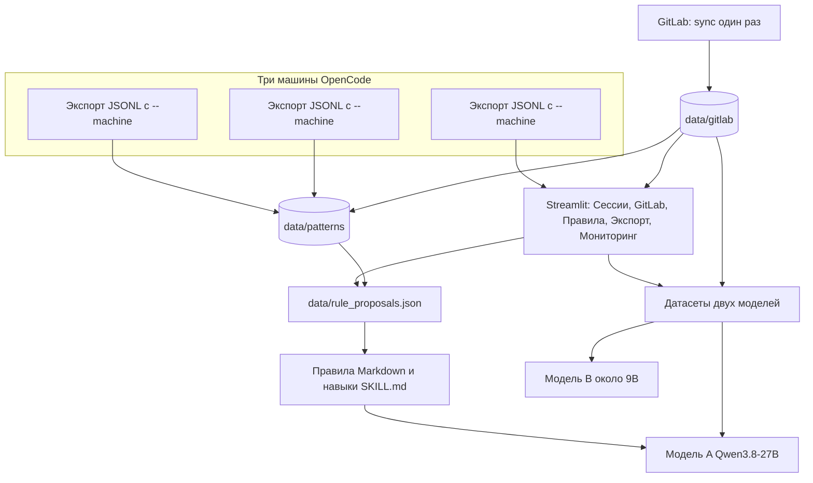

# finetune-curator

## Цели

Пайплайн собирает историю работы агента и ревью в GitLab в два набора для дообучения и в правила, которыми агент пользуется сразу.

Две модели:

- **Модель A, автор кода, около 27B.** Базовый чекпоинт `Qwen/Qwen3.8-27B`. Учится на успешных траекториях OpenCode, на парах DPO из правок пользователя и на стиле проекта: полировка тимлида и правки после комментария ревьюера. В системный промпт и в `.opencode/skills` рядом с ней кладутся одобренные правила и навыки.
- **Модель B, ревьюер, около 9B.** Кандидаты: `Qwen/Qwen3.5-9B` и `deepreinforce-ai/Ornith-1.0-9B`. Этап 1: модель видит уже собранный контекст (дифф, описание MR, связанные задачи, код на базовом коммите, определения символов, одобренные правила) и пишет комментарий. Агентное ревью с инструментами только на чтение — отдельная будущая задача.

Правила и навыки — третий результат, не третья модель. Правило — короткая императивная инструкция для системного промпта или `AGENTS.md`. Навык — пошаговый сценарий под один тип задачи в формате OpenCode `SKILL.md`. Оба живут в одном файле предложений и проходят одну страницу одобрения.

На этой ветке готовы выгрузка OpenCode (с меткой машины `--machine`), просмотр сессий и предложения правил с одной сессии (`mode: per-session`). GitLab, кластеры по корпусу и отдельные датасеты двух моделей добавляются следующими изменениями. Оценка LogMiner — структурный фильтр, а не метка «сессия удалась».

## Архитектура

Один процесс Streamlit (`streamlit run viewer/app.py`) и один файл предложений. Отдельного второго пайплайна для правил нет. Режим «предложение с одной сессии» (`mode: per-session`) — частный случай. Корпусный разбор позже пишет в тот же `data/rule_proposals.json`.



Границы, к которым сходится код: `ingest` (OpenCode и GitLab), `llm` (общий клиент), `analysis` (кластеры), `proposals` (один файл предложений), `datasets`, `training`, `viewer`. На этой ветке клиент, предложения и просмотр сессий лежат в `scripts/rules`, `scripts/export_opencode.py` и `viewer/`.

## Что уже есть на этой ветке

Выгрузка LogMiner, ручной просмотр Keep/Discard и экспорт только одобренных сессий. Тот же просмотр предлагает правила для системного промпта или `AGENTS.md`: ошибки, правки пользователя, циклы, неверные инструменты.

Источники LogMiner: OpenCode, Claude Code, Cline, Codex, Qwen.

1. **Выгрузка** — тонкая обёртка над [LogMiner](https://github.com/pearsonkyle/LogMiner).
2. **Одно приложение Streamlit** — `streamlit run viewer/app.py`. Общие пути: сессии OpenCode, предложения правил и навыков, экспорт. Страницы GitLab и мониторинга подключаются следующими изменениями.
3. **Экспорт одобренных сессий** — JSONL только с Keep, для Unsloth.
4. **Предложения** — один список (`kind`: rule или skill, текст, сессии-источники, статус, `mode`). Сейчас режим `per-session`. Позже корпус пишет в тот же файл и ту же страницу одобрения.

Старый файл `{"rules":[...]}` без поля `mode` читается как черновики `per-session`. Предложение с `source: gitlab` так не помечается. Одобренное предложение не удаляется, когда корпус вычищает черновики.

## Установка

```bash
python -m venv .venv
source .venv/bin/activate   # Windows: .venv\Scripts\activate
pip install -r requirements.txt

# LogMiner (install from git)
pip install "git+https://github.com/pearsonkyle/LogMiner.git"
```

## Быстрый старт

### 1. Выгрузить OpenCode

```bash
# Все оценки, чтобы просмотреть вручную
python -m scripts.export_opencode --output data/raw_scored.jsonl --min-score 0.0 --machine laptop-a
```

По умолчанию OpenCode читается из `~/.local/share/opencode`. Другой путь: `--input`. `--machine` пишет метку на каждую строку и не затирает оценку LogMiner. Рядом ищется только scored-файл этого же экспорта, не чужой `*_scored.jsonl`.

### 2. Просмотр в интерфейсе

```bash
streamlit run viewer/app.py -- --input data/raw_scored.jsonl
```

- Фильтр по оценке и метке
- Траектория: пользователь, ассистент, инструменты
- **Keep** или **Discard**
- Заметка, почему сессия не удалась или что поправил пользователь
- Решения пишутся в `data/decisions.json`

### 3. Экспорт только одобренных сессий

```bash
python -m scripts.export_approved \
  --input data/raw_scored.jsonl \
  --decisions data/decisions.json \
  --output data/approved.jsonl
```

Загрузка в Unsloth / HuggingFace:

```python
from datasets import load_dataset
import json

ds = load_dataset("json", data_files="data/approved.jsonl", split="train")
msgs = [json.loads(m) for m in ds[0]["messages"]]
```

### 4. Предложить правила

Черновики берутся из сессий Discard, сессий с оценкой не выше `--max-score` (по умолчанию `0.6`, плюс метки LogMiner `bad` / `maybe`) и сессий с заметкой. Правило — короткая императивная инструкция: категория, обоснование, id сессий, короткая цитата. Похожие формулировки сливаются. У каждого предложения `mode: per-session`.

Подойдёт любой OpenAI-совместимый chat API. По умолчанию локальный [llama.cpp](https://github.com/ggml-org/llama.cpp) `llama-server`:

```text
http://localhost:8080/v1
```

Ключ там необязателен. Если `--model` не задан, берётся единственный id из `GET /v1/models`.

```bash
python -m scripts.propose_rules \
  --input data/raw_scored.jsonl \
  --decisions data/decisions.json \
  --output data/rule_proposals.json \
  --base-url http://localhost:8080/v1 \
  --context-budget 170000
```

Проверка без сервера, готовый ответ, без сети:

```bash
python -m scripts.propose_rules \
  --input data/raw_scored.jsonl \
  --decisions data/decisions.json \
  --output data/rule_proposals.json \
  --mock-response tests/fixtures/sample_rules_response.txt
```

### 5. Одобрить правила

Откройте просмотр из шага 2 и перейдите на страницу **Правила**.

- Правьте текст и категорию
- **Одобрить** / **Отклонить**
- Кнопка сессии возвращает к траектории
- Решения — в `data/rule_decisions.json`, предложения остаются в `data/rule_proposals.json`

```bash
streamlit run viewer/app.py -- \
  --input data/raw_scored.jsonl \
  --decisions data/decisions.json \
  --rules data/rule_proposals.json \
  --rule-decisions data/rule_decisions.json
```

### 6. Экспорт одобренных правил

Markdown сгруппирован по категориям и готов в системный промпт или `AGENTS.md`. JSON хранит id, текст, категорию, обоснование, сессии, цитату и `mode`. Пишутся только **одобренные** правила. Отредактированный текст побеждает.

```bash
python -m scripts.export_rules \
  --proposals data/rule_proposals.json \
  --decisions data/rule_decisions.json \
  --markdown data/approved_rules.md \
  --json data/approved_rules.json
```

## Локальный llama.cpp

По умолчанию сервер с контекстом около **200k** токенов. `--context-budget` (по умолчанию **170000**) — бюджет входа: место остаётся на инструкцию и JSON-ответ (`--max-output-tokens`, по умолчанию 4096). Обычная сессия OpenCode уходит целиком. Если не влезает, режется по границам сообщений. Короткие сессии пакуются в один запрос. Уменьшите бюджет, если `llama-server` запущен с меньшим `-c` (например `--context-budget 12000` на сервере 16k).

Оценка длины — `символы / --chars-per-token` (по умолчанию `3`: для английского с запасом). Если сервер сообщает о переполнении контекста, уменьшите `--chars-per-token`. `--no-batch` шлёт каждый кусок отдельно.

Кванты GGUF семейства Qwen3 (например Unsloth Q5_K_XL около 27B) пишут блок `<think>`, пока рассуждение не выключено. Скрипт добавляет `/no_think` и `chat_template_kwargs.enable_thinking=false`. Перед разбором JSON теги `<think>…</think>` всё равно вырезаются. Плохой JSON повторяется (`--attempts`, по умолчанию 3). Температура `0.1`. `--think` оставляет рассуждение. `--no-template-kwargs` убирает дополнительное поле, если сервер его отвергает. Имя модели в коде не зашито.

```bash
llama-server \
  -m /path/to/Qwen3-27B-Q5_K_XL.gguf \
  -c 200000 \
  --jinja \
  --host 127.0.0.1 \
  --port 8080

python -m scripts.propose_rules \
  --input data/raw_scored.jsonl \
  --decisions data/decisions.json \
  --output data/rule_proposals.json \
  --base-url http://127.0.0.1:8080/v1 \
  --context-budget 170000
```

`--jinja` включает шаблон чата из GGUF. Без него `/no_think` и `enable_thinking` не сработают. Проверка id:

```bash
curl -s http://127.0.0.1:8080/v1/models
python -m scripts.propose_rules --list-models --base-url http://127.0.0.1:8080/v1
```

Если сервер отдаёт несколько id, закрепите `--model <id>`.

## Конфиг провайдера OpenCode

Если модель уже настроена в OpenCode, выберите её как `provider/model`. Проектный `opencode.json` / `opencode.jsonc` (включая `.opencode/`) важнее `~/.config/opencode/opencode.json`. Читаются и текущий вид `providers.*.settings.baseURL`, и старый `provider.*.options.baseURL`. В API уходит `modelID`. Ключ берётся из `apiKey` / `api_key` или списка `env` провайдера.

```bash
python -m scripts.propose_rules --list-opencode-models
python -m scripts.propose_rules --print-endpoint --from-opencode llama/qwen3-27b

python -m scripts.propose_rules \
  --input data/raw_scored.jsonl \
  --decisions data/decisions.json \
  --from-opencode llama/qwen3-27b
```

Порядок, от сильного к слабому: флаги `--base-url`, `--api-key`, `--model`, затем `FINETUNE_CURATOR_BASE_URL` / `FINETUNE_CURATOR_API_KEY` / `FINETUNE_CURATOR_MODEL`, затем `OPENAI_BASE_URL` / `OPENAI_API_KEY` / `OPENAI_MODEL`, затем запись OpenCode, затем адрес llama-server по умолчанию. У адреса без пути дописывается `/v1`.

```bash
export FINETUNE_CURATOR_BASE_URL=http://127.0.0.1:8080/v1
export FINETUNE_CURATOR_MODEL=qwen3-27b-q5
# FINETUNE_CURATOR_API_KEY для llama-server можно не задавать
```

`--print-endpoint` показывает модель и адрес и не печатает ключ.

## Каталог файлов

```
finetune-curator/
├── README.md
├── requirements.txt
├── .gitignore
├── scripts/
│   ├── export_opencode.py    # обёртка LogMiner
│   ├── export_approved.py    # JSONL только Keep
│   ├── propose_rules.py      # предложения правил
│   ├── export_rules.py       # одобренные правила → Markdown + JSON
│   └── rules/                # отбор, слияние, адрес модели, экспорт
├── viewer/
│   └── app.py                # одно приложение Streamlit
├── tests/
└── data/                     # только локально
```

## Тесты

```bash
python -m pytest
```

Покрыты слияние правил, JSON вместе с тегами рассуждения, нарезка длинных сессий, файлы решений, оба экспорта, разбор конфига OpenCode и цепочка `propose_rules` → `export_rules` на canned-ответе. Живая модель не вызывается.

## Заметки

- Оценка LogMiner — структурный фильтр, а не метка успеха. Просматривайте Keep и одобренные правила.
- После обновления OpenCode (схема v1 → v2) пересоберите выгрузку. Если разбор падает, проверьте `opencode --version` и таблицы базы.
- Не коммитьте реальные сессии и экспортированные правила: в них бывают секреты. `data/*.jsonl`, `data/*.json` и `data/*.md` в `.gitignore`.
- Id правила — хеш категории и нормализованного текста. Повторное одобрение той же формулировки сохраняет решение. Правка текста в интерфейсе id не меняет.

## Лицензия

MIT
