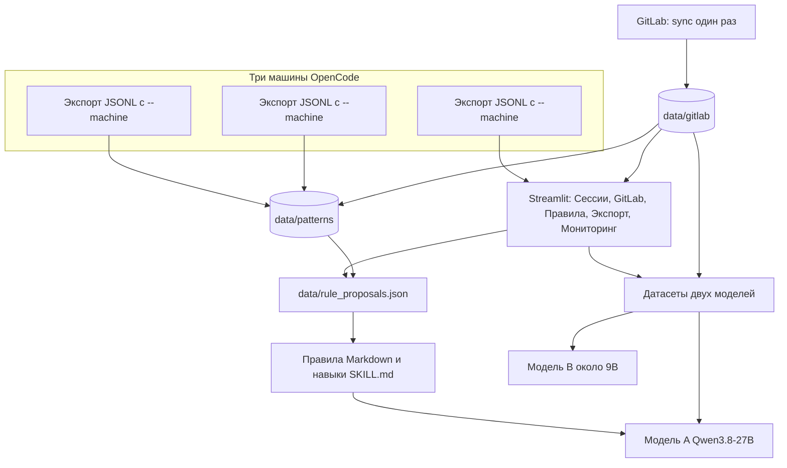

# finetune-curator

## Цели

Пайплайн собирает историю работы агента и ревью в GitLab в два набора для дообучения и в правила, которыми агент пользуется сразу.

Две модели:

- **Модель A, автор кода, около 27B.** Базовый чекпоинт `Qwen/Qwen3.8-27B`. Учится на успешных траекториях OpenCode, на парах DPO из правок пользователя и на стиле проекта: полировка тимлида и правки после комментария ревьюера. В системный промпт и в `.opencode/skills` рядом с ней кладутся одобренные правила и навыки.
- **Модель B, ревьюер, около 9B.** Кандидаты: `Qwen/Qwen3.5-9B` и `deepreinforce-ai/Ornith-1.0-9B`. Этап 1: модель видит уже собранный контекст (дифф, описание MR, связанные задачи, код на базовом коммите, определения символов, одобренные правила) и пишет комментарий. Агентное ревью с инструментами только на чтение — отдельная будущая задача.

Правила и навыки — третий результат, не третья модель. Правило — короткая императивная инструкция для системного промпта или `AGENTS.md`. Навык — пошаговый сценарий под один тип задачи в формате OpenCode `SKILL.md`. Оба живут в одном файле предложений и проходят одну страницу одобрения.

На этой ветке готовы выгрузка OpenCode (с меткой машины `--machine`), просмотр сессий и предложения правил с одной сессии (`mode: per-session`). GitLab, кластеры по корпусу и отдельные датасеты двух моделей добавляются следующими изменениями. Оценка LogMiner — структурный фильтр, а не метка «сессия удалась».

## Архитектура

Один процесс Streamlit (`streamlit run viewer/app.py`) и один файл предложений. Отдельного второго пайплайна для правил нет. Режим «предложение с одной сессии» (`mode: per-session`) — частный случай. Корпусный разбор позже пишет в тот же `data/rule_proposals.json`.



Границы, к которым сходится код: `ingest` (OpenCode и GitLab), `llm` (общий клиент), `analysis` (кластеры), `proposals` (один файл предложений), `datasets`, `training`, `viewer`. На этой ветке клиент, предложения и просмотр сессий лежат в `scripts/rules`, `scripts/export_opencode.py` и `viewer/`.

## Что уже есть на этой ветке

Выгрузка LogMiner, ручной просмотр Keep/Discard и экспорт только одобренных сессий. Тот же просмотр предлагает правила для системного промпта или `AGENTS.md`: ошибки, правки пользователя, циклы, неверные инструменты.

Источники LogMiner: OpenCode, Claude Code, Cline, Codex, Qwen.

Источники: OpenCode и слитые merge request GitLab.

1. **Выгрузка** — тонкая обёртка над [LogMiner](https://github.com/pearsonkyle/LogMiner).
2. **Одно приложение Streamlit** — `streamlit run viewer/app.py`. Общие пути: сессии OpenCode, MR GitLab, предложения, экспорт.
3. **Экспорт одобренных сессий** — JSONL только с Keep, для Unsloth.
4. **Предложения** — один список (`kind`: rule или skill). Правила с сессий и из комментариев GitLab пишутся в один файл.
5. **Ревью GitLab** — слитые MR становятся примерами SFT и DPO. Связанный комментарий можно предложить как правило.

Старый файл `{"rules":[...]}` без поля `mode` читается как черновики `per-session`. Предложение с `source: gitlab` так не помечается. Одобренное предложение не удаляется, когда корпус вычищает черновики. На этой ветке корпус ещё и ищет повторяющиеся ошибки по нескольким машинам.

Файлы правил — отдельный результат, не вместо датасета сессий.

## Установка

```bash
python -m venv .venv
source .venv/bin/activate   # Windows: .venv\Scripts\activate
pip install -r requirements.txt

# LogMiner (install from git)
pip install "git+https://github.com/pearsonkyle/LogMiner.git"
```

## Быстрый старт

### 1. Выгрузить OpenCode

```bash
# Все оценки, чтобы просмотреть вручную
python -m scripts.export_opencode --output data/raw_scored.jsonl --min-score 0.0 --machine laptop-a
```

По умолчанию OpenCode читается из `~/.local/share/opencode`. Другой путь: `--input`. `--machine` пишет метку на каждую строку и не затирает оценку LogMiner. Рядом ищется только scored-файл этого же экспорта, не чужой `*_scored.jsonl`.

### 2. Просмотр в интерфейсе

```bash
streamlit run viewer/app.py -- --input data/raw_scored.jsonl
```

- Фильтр по оценке и метке
- Траектория: пользователь, ассистент, инструменты
- **Keep** или **Discard**
- Заметка, почему сессия не удалась или что поправил пользователь
- Решения пишутся в `data/decisions.json`

### 3. Экспорт только одобренных сессий

```bash
python -m scripts.export_approved \
  --input data/raw_scored.jsonl \
  --decisions data/decisions.json \
  --output data/approved.jsonl
```

Загрузка в Unsloth / HuggingFace:

```python
from datasets import load_dataset
import json

ds = load_dataset("json", data_files="data/approved.jsonl", split="train")
msgs = [json.loads(m) for m in ds[0]["messages"]]
```

### 4. Предложить правила

Черновики берутся из сессий Discard, сессий с оценкой не выше `--max-score` (по умолчанию `0.6`, плюс метки LogMiner `bad` / `maybe`) и сессий с заметкой. Правило — короткая императивная инструкция: категория, обоснование, id сессий, короткая цитата. Похожие формулировки сливаются. У каждого предложения `mode: per-session`.

Подойдёт любой OpenAI-совместимый chat API. По умолчанию локальный [llama.cpp](https://github.com/ggml-org/llama.cpp) `llama-server`:

```text
http://localhost:8080/v1
```

Ключ там необязателен. Если `--model` не задан, берётся единственный id из `GET /v1/models`.

```bash
python -m scripts.propose_rules \
  --input data/raw_scored.jsonl \
  --decisions data/decisions.json \
  --output data/rule_proposals.json \
  --base-url http://localhost:8080/v1 \
  --context-budget 170000
```

Проверка без сервера, готовый ответ, без сети:

```bash
python -m scripts.propose_rules \
  --input data/raw_scored.jsonl \
  --decisions data/decisions.json \
  --output data/rule_proposals.json \
  --mock-response tests/fixtures/sample_rules_response.txt
```

### 5. Одобрить правила

Откройте просмотр из шага 2 и перейдите на страницу **Правила**.

- Правьте текст и категорию
- **Одобрить** / **Отклонить**
- Кнопка сессии возвращает к траектории
- Решения — в `data/rule_decisions.json`, предложения остаются в `data/rule_proposals.json`

```bash
streamlit run viewer/app.py -- \
  --input data/raw_scored.jsonl \
  --decisions data/decisions.json \
  --rules data/rule_proposals.json \
  --rule-decisions data/rule_decisions.json
```

### 6. Экспорт одобренных правил

Markdown сгруппирован по категориям и готов в системный промпт или `AGENTS.md`. JSON хранит id, текст, категорию, обоснование, сессии, цитату и `mode`. Пишутся только **одобренные** правила. Отредактированный текст побеждает.

```bash
python -m scripts.export_rules \
  --proposals data/rule_proposals.json \
  --decisions data/rule_decisions.json \
  --markdown data/approved_rules.md \
  --json data/approved_rules.json
```

## Локальный llama.cpp

По умолчанию сервер с контекстом около **200k** токенов. `--context-budget` (по умолчанию **170000**) — бюджет входа: место остаётся на инструкцию и JSON-ответ (`--max-output-tokens`, по умолчанию 4096). Обычная сессия OpenCode уходит целиком. Если не влезает, режется по границам сообщений. Короткие сессии пакуются в один запрос. Уменьшите бюджет, если `llama-server` запущен с меньшим `-c` (например `--context-budget 12000` на сервере 16k).

Оценка длины — `символы / --chars-per-token` (по умолчанию `3`: для английского с запасом). Если сервер сообщает о переполнении контекста, уменьшите `--chars-per-token`. `--no-batch` шлёт каждый кусок отдельно.

Кванты GGUF семейства Qwen3 (например Unsloth Q5_K_XL около 27B) пишут блок `<think>`, пока рассуждение не выключено. Скрипт добавляет `/no_think` и `chat_template_kwargs.enable_thinking=false`. Перед разбором JSON теги `<think>…</think>` всё равно вырезаются. Плохой JSON повторяется (`--attempts`, по умолчанию 3). Температура `0.1`. `--think` оставляет рассуждение. `--no-template-kwargs` убирает дополнительное поле, если сервер его отвергает. Имя модели в коде не зашито.

```bash
llama-server \
  -m /path/to/Qwen3-27B-Q5_K_XL.gguf \
  -c 200000 \
  --jinja \
  --host 127.0.0.1 \
  --port 8080

python -m scripts.propose_rules \
  --input data/raw_scored.jsonl \
  --decisions data/decisions.json \
  --output data/rule_proposals.json \
  --base-url http://127.0.0.1:8080/v1 \
  --context-budget 170000
```

`--jinja` включает шаблон чата из GGUF. Без него `/no_think` и `enable_thinking` не сработают. Проверка id:

```bash
curl -s http://127.0.0.1:8080/v1/models
python -m scripts.propose_rules --list-models --base-url http://127.0.0.1:8080/v1
```

Если сервер отдаёт несколько id, закрепите `--model <id>`.

## Конфиг провайдера OpenCode

Если модель уже настроена в OpenCode, выберите её как `provider/model`. Проектный `opencode.json` / `opencode.jsonc` (включая `.opencode/`) важнее `~/.config/opencode/opencode.json`. Читаются и текущий вид `providers.*.settings.baseURL`, и старый `provider.*.options.baseURL`. В API уходит `modelID`. Ключ берётся из `apiKey` / `api_key` или списка `env` провайдера.

```bash
python -m scripts.propose_rules --list-opencode-models
python -m scripts.propose_rules --print-endpoint --from-opencode llama/qwen3-27b

python -m scripts.propose_rules \
  --input data/raw_scored.jsonl \
  --decisions data/decisions.json \
  --from-opencode llama/qwen3-27b
```

Порядок, от сильного к слабому: флаги `--base-url`, `--api-key`, `--model`, затем `FINETUNE_CURATOR_BASE_URL` / `FINETUNE_CURATOR_API_KEY` / `FINETUNE_CURATOR_MODEL`, затем `OPENAI_BASE_URL` / `OPENAI_API_KEY` / `OPENAI_MODEL`, затем запись OpenCode, затем адрес llama-server по умолчанию. У адреса без пути дописывается `/v1`.

```bash
export FINETUNE_CURATOR_BASE_URL=http://127.0.0.1:8080/v1
export FINETUNE_CURATOR_MODEL=qwen3-27b-q5
# FINETUNE_CURATOR_API_KEY для llama-server можно не задавать
```

`--print-endpoint` показывает модель и адрес и не печатает ключ.

## Ревью merge request в GitLab

История ревью компании остаётся на диске. Фаза 1 ходит в GitLab. Фаза 2 — нет.

**Фаза 1 — sync.** Слитые MR (описание, обсуждения с якорями, коммиты, диффы, текст файлов на коммите и на родителе) попадают в `data/gitlab/` (SQLite и сырой JSON, в gitignore). Повторный запуск пропускает уже сохранённые MR. `--refresh project!iid` перекачивает один MR. Токен — `GITLAB_TOKEN`, в лог и в склад он не пишется.

```bash
export GITLAB_TOKEN=...   # scope api. Не коммитьте токен.
python -m scripts.export_gitlab_mrr sync \
  --base-url https://gitlab.company.internal \
  --ca-bundle /path/to/company-ca.pem \
  --group my-group \
  --since 2025-01-01 \
  --until 2026-01-01

# позже забираются только новые MR
python -m scripts.export_gitlab_mrr sync \
  --base-url https://gitlab.company.internal \
  --group my-group

# перекачать один MR
python -m scripts.export_gitlab_mrr sync \
  --base-url https://gitlab.company.internal \
  --refresh group/app!42
```

`--project group/app` можно повторять. Вложенные группы не обрезаются: `https://gitlab.example.com/group/nested/app/-/merge_requests/7` хранится и обновляется как `group/nested/app!7`. `--insecure` отключает проверку TLS. Связанные задачи читаются из заголовка и описания, в том числе `group/project#123` и полный URL `grp/sub/proj/-/issues/5`. Ошибка запроса задачи пишется в лог, sync продолжается. Текст задачи лежит в SQLite и в `issues.json`.

Комментарии всех ревьюеров сохраняются, с ролью автора на MR (author, reviewer, assignee, commenter). `--reviewer` только фильтрует список и страницу, обработку он не сужает.

У комментария есть якорь: SHA `base` / `start` / `head`, путь, старый и новый диапазон строк, фрагмент. Связь «комментарий, потом правка» — более поздний коммит, который задел эти строки. Коммиты тимлида и коммиты с заголовком MRR в эту связь не входят: это полировка, не исправление комментария. Заголовок сам по себе коммит с комментарием не связывает. Тред помнит, закрыт ли он, кем и какие были ответы. Статус: `linked`, `addressed_elsewhere`, `not_addressed`, `unclear`.

Тимлид один. `gitlab.json` называет его один раз и перечисляет псевдонимы (`team_lead.aliases`: username, имя, почта). `--team-lead` добавляет ещё один псевдоним того же человека. Каждый его коммит становится парой до/после. Регулярное выражение `mrr_pattern` (по умолчанию `\bmrr\b`) помечает полировку. Роли коммита: `author`, `author_fix`, `team_lead_mrr`, `team_lead_other`, `other`.

**Фаза 2 — обработка офлайн.** MR выбираются на странице **GitLab** (`streamlit run viewer/app.py`: проект, автор, ревьюер, даты, связанные комментарии, число комментариев) или в CLI. `--reviewer` и `--linked-only` фильтруют только список. Обработка пишет всех ревьюеров. `--linked-only` оставляет MR, у которых уже есть комментарий, связанный с поздним коммитом; это не счётчик MRR-коммитов тимлида. Страница MR — один таймлайн коммитов и комментариев. Коммиты тимлида подсвечены, заголовки MRR помечены, у ханка есть вид до/после. Ручная связь хранится отдельно и перекрывает автоматическую. Скопируйте `gitlab.example.json` в `gitlab.json`. Связанный комментарий — самый ранний поздний коммит на тех же строках (уверенность 0.8, или 0.9 если тред закрыт). Тот же файл без пересечения строк — `addressed_elsewhere` (0.55).

Примеры и правки Keep/Discard лежат отдельно от сырого MR, поэтому обработку можно повторить без сети. `--anonymize` заменяет имена и почты в примерах. `--anonymize-urls` ещё и URL. Сырой склад не меняется.

```bash
python -m scripts.export_gitlab_mrr list --linked-only

python -m scripts.export_gitlab_mrr process \
  --mr group/app!42 --mr group/app!43 \
  --team-lead team.lead \
  --anonymize --anonymize-urls

python -m scripts.export_gitlab_mrr process --all
```

В интерфейсе откройте MR (описание, комментарии, диффы), оставьте или отбросьте пример и поправьте учебный текст. Решение переживает повторную обработку того же MR.

Экспорт пишет строки `keep`, если не передан `--status`. SFT — JSONL `messages` для Unsloth. DPO — `prompt` / `chosen` / `rejected` (rejected — код до правки).

```bash
python -m scripts.export_gitlab_mrr export \
  --status keep \
  --sft data/gitlab_sft.jsonl \
  --dpo data/gitlab_dpo.jsonl
```

Необязательное предложение правил идёт тем же LLM, что и правила сессий, и в GitLab не ходит. Такие предложения получают `source: gitlab` и не помечаются `per-session`. `--mock-response` полностью обходится без сети:

```bash
python -m scripts.export_gitlab_mrr process \
  --mr group/app!42 \
  --rules \
  --mock-response tests/fixtures/sample_rules_response.txt
```

Одобряйте их на странице **Правила**. `gitlab_review` не входит в источники сессий по умолчанию.

Проверка обеих фаз на записанной фикстуре:

```bash
GITLAB_TOKEN=example python -m scripts.export_gitlab_mrr sync \
  --base-url https://gitlab.example.com \
  --project group/app \
  --fixture tests/fixtures/gitlab_api.json \
  --store /tmp/gitlab-store

python -m scripts.export_gitlab_mrr process \
  --store /tmp/gitlab-store \
  --mr group/app!7 \
  --anonymize
```

## Поиск паттернов

Это не повторный прогон агента и не A/B harness. Скрипт смотрит много сессий OpenCode и, если есть склад GitLab, следы «комментарий, потом правка» и ханки полировки тимлида. Рекомендация — общее правило или навык под один тип задачи.

Истории нескольких машин попадают в `data/patterns/` (gitignore). Одна и та же сессия в двух выгрузках хранится один раз и помечается всеми машинами. Повторный импорт добавляет только новые сессии источника. SQLite OpenCode читается как `opencode-v2` (JSON session/message/part), `opencode-v1` (колонки role/content) или blob сессии. Незнакомая схема печатает список таблиц и останавливается.

```bash
python -m scripts.mine_patterns import --source laptop-a --input data/laptop-a.jsonl
python -m scripts.mine_patterns import --source laptop-b --input ~/.local/share/opencode/opencode.db
python -m scripts.mine_patterns import --source gitlab --gitlab-store data/gitlab

python -m scripts.mine_patterns annotate --base-url http://127.0.0.1:8080/v1
python -m scripts.mine_patterns cluster --min-size 3
python -m scripts.mine_patterns recommend --base-url http://127.0.0.1:8080/v1
```

Аннотация — один JSON на сессию: тип задачи, проект, инструменты, исход, где сломалось, как поправил пользователь, что сработало. Готовые сессии пропускаются. Кластеры используют эмбеддинги, если заданы `--embeddings-url` и `--embeddings-model`, иначе косинус TF-IDF. Меньше `--min-size` (по умолчанию 3) — шум, рекомендация не строится.

Паттерн становится **правилом**, только если в нём не меньше трёх типов задач. Иначе это **навык**: `.opencode/skills/<id>/SKILL.md` (YAML `name` и `description`, затем шаги и примеры). Конфликты с уже существующим текстом и с тем же типом ошибки на успешных сессиях сохраняются.

`recommend` пишет в `data/rule_proposals.json` (`mode: corpus`) и убирает черновики `per-session`. Одобренные предложения и предложения GitLab при этом не удаляются. Одобряйте их на странице **Правила**. Там же кластеры и переход к сессии или комментарию. Страница **Мониторинг** показывает метрики до/после и откат. `--min-size 1` оставляет одиночные кластеры для отладки.

```bash
python -m scripts.mine_patterns export \
  --rules-md data/patterns_rules.md \
  --rules-json data/patterns_rules.json \
  --skills-dir skills \
  --version v1

python -m scripts.mine_patterns report --decisions data/decisions.json --error-type loop
python -m scripts.mine_patterns rollback --version v1
```

Экспорт запоминает версии файлов и время. Отчёт сравнивает сессии до и после: средняя оценка LogMiner, доля Discard, как часто возвращается тип ошибки, как часто пользователь поправлял агента. Откат копирует файлы той версии и снимает более поздние. Повторного прогона агента нет.

`annotate` и `recommend` принимают `--mock-response`. Живой адрес по умолчанию — тот же llama-server (`http://localhost:8080/v1`, рассуждение выключено, низкая температура).

## Каталог файлов

```
finetune-curator/
├── README.md
├── requirements.txt
├── .gitignore
├── scripts/
│   ├── export_opencode.py    # обёртка LogMiner
│   ├── export_approved.py    # JSONL только Keep
│   ├── propose_rules.py      # предложения правил
│   ├── export_rules.py       # одобренные правила
│   ├── export_gitlab_mrr.py  # sync, обработка, экспорт GitLab
│   ├── mine_patterns.py      # импорт, аннотация, кластеры, откат
│   ├── rules/                # отбор, слияние, адрес модели
│   ├── gitlab/               # клиент, склад, связь, анонимизация
│   └── patterns/             # несколько машин, кластеры, навыки
├── viewer/
│   └── app.py                # сессии, GitLab, правила, экспорт, мониторинг
├── tests/
└── data/                     # только локально
```

## Тесты

```bash
python -m pytest
```

Покрыты слияние правил, JSON вместе с тегами рассуждения, нарезка длинных сессий, файлы решений, оба экспорта, разбор конфига OpenCode, цепочка `propose_rules` → `export_rules` и экспорт GitLab по записанной фикстуре. Живые модель и GitLab не вызываются.

## Заметки

- Оценка LogMiner — структурный фильтр, а не метка успеха. Просматривайте Keep и одобренные правила.
- После обновления OpenCode (схема v1 → v2) пересоберите выгрузку. Если разбор падает, проверьте `opencode --version` и таблицы базы.
- Не коммитьте реальные сессии и экспортированные правила: в них бывают секреты. `data/*.jsonl`, `data/*.json` и `data/*.md` в `.gitignore`.
- Id правила — хеш категории и нормализованного текста. Повторное одобрение той же формулировки сохраняет решение. Правка текста в интерфейсе id не меняет.

## Лицензия

MIT
