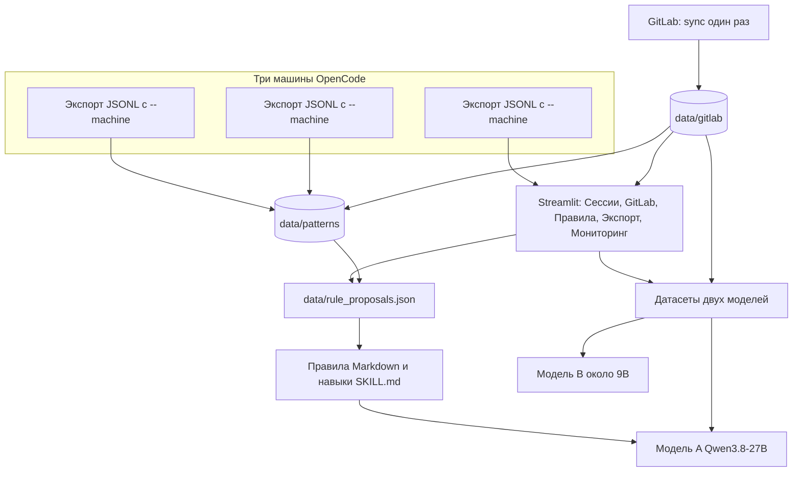

# finetune-curator

## Цели

Пайплайн собирает историю работы агента и ревью в GitLab в два набора для дообучения и в правила, которыми агент пользуется сразу.

Две модели:

- **Модель A, автор кода, около 27B.** Базовый чекпоинт `Qwen/Qwen3.8-27B`. Учится на успешных траекториях OpenCode, на парах DPO из правок пользователя и на стиле проекта: полировка тимлида и правки после комментария ревьюера. В системный промпт и в `.opencode/skills` рядом с ней кладутся одобренные правила и навыки.
- **Модель B, ревьюер, около 9B.** Кандидаты: `Qwen/Qwen3.5-9B` и `deepreinforce-ai/Ornith-1.0-9B`. Этап 1: модель видит уже собранный контекст (дифф, описание MR, связанные задачи, код на базовом коммите, определения символов, одобренные правила) и пишет комментарий. Агентное ревью с инструментами только на чтение — отдельная будущая задача.

Правила и навыки — третий результат, не третья модель. Правило — короткая императивная инструкция для системного промпта или `AGENTS.md`. Навык — пошаговый сценарий под один тип задачи в формате OpenCode `SKILL.md`. Оба живут в одном файле предложений и проходят одну страницу одобрения.

На этой ветке готовы выгрузка OpenCode (с меткой машины `--machine`), просмотр сессий и предложения правил с одной сессии (`mode: per-session`). GitLab, кластеры по корпусу и отдельные датасеты двух моделей добавляются следующими изменениями. Оценка LogMiner — структурный фильтр, а не метка «сессия удалась».

## Архитектура

Один процесс Streamlit (`streamlit run viewer/app.py`) и один файл предложений. Отдельного второго пайплайна для правил нет. Режим «предложение с одной сессии» (`mode: per-session`) — частный случай. Корпусный разбор позже пишет в тот же `data/rule_proposals.json`.



Границы, к которым сходится код: `ingest` (OpenCode и GitLab), `llm` (общий клиент), `analysis` (кластеры), `proposals` (один файл предложений), `datasets`, `training`, `viewer`. На этой ветке клиент, предложения и просмотр сессий лежат в `scripts/rules`, `scripts/export_opencode.py` и `viewer/`.

## What this branch does

Pipeline: **LogMiner export → visual review (keep/discard) → export only approved** for Unsloth / SFT.

The same review pass can mine a second artifact: **harness rules** for the agent system prompt or `AGENTS.md` (mistakes, user corrections, loops, tool misuse).

Works with OpenCode (and other LogMiner sources: Claude Code, Cline, Codex, Qwen) and with merged GitLab merge requests.

## What you get

1. **Export** — thin wrapper around [LogMiner](https://github.com/pearsonkyle/LogMiner) for OpenCode history
2. **One Streamlit app** — `streamlit run viewer/app.py`. Shared navigation and paths: OpenCode sessions, GitLab MRs, proposals, and export.
3. **Export approved** — writes only kept sessions to a clean JSONL ready for Unsloth
4. **Proposals** — one shared list (`kind`: rule or skill, text, source session ids, status). Per-session generation and GitLab review comments write that same file, and the same viewer page approves them.
5. **GitLab reviews** — merged MRs become SFT and DPO examples, and linked review comments can be proposed as rules through the shared proposal file.

The dataset flow is unchanged. Rule files are a separate output.

## Install

```bash
python -m venv .venv
source .venv/bin/activate   # Windows: .venv\Scripts\activate
pip install -r requirements.txt

# LogMiner (install from git)
pip install "git+https://github.com/pearsonkyle/LogMiner.git"
```

## Quick start

### 1. Export from OpenCode

```bash
# Keep all scores for manual review
python -m scripts.export_opencode --output data/raw_scored.jsonl --min-score 0.0 --machine laptop-a
```

OpenCode data is read from `~/.local/share/opencode` by default (override with `--input`).

### 2. Review in the viewer

```bash
streamlit run viewer/app.py -- --input data/raw_scored.jsonl
```

- Filter by score / label
- Open each trajectory (user / assistant / tool turns)
- Press **Keep** or **Discard**
- Optional note per session (why it failed, what the user corrected)
- Decisions are saved to `data/decisions.json`

### 3. Export only approved sessions

```bash
python -m scripts.export_approved \
  --input data/raw_scored.jsonl \
  --decisions data/decisions.json \
  --output data/approved.jsonl
```

Load into Unsloth / HuggingFace:

```python
from datasets import load_dataset
import json

ds = load_dataset("json", data_files="data/approved.jsonl", split="train")
msgs = [json.loads(m) for m in ds[0]["messages"]]
```

### 4. Propose harness rules

Rules are drafted from sessions you discarded, sessions under `--max-score` (default `0.6`, plus LogMiner labels `bad` / `maybe`), and any session with a reviewer note. Each rule is a short imperative instruction, with a category, rationale, source session ids, and a short evidence excerpt. Similar rules are merged.

Any OpenAI-compatible chat API works. The default endpoint is a local [llama.cpp](https://github.com/ggml-org/llama.cpp) `llama-server`:

```text
http://localhost:8080/v1
```

The API key is optional there. If you omit `--model`, the script uses the only id returned by `GET /v1/models`.

```bash
python -m scripts.propose_rules \
  --input data/raw_scored.jsonl \
  --decisions data/decisions.json \
  --output data/rule_proposals.json \
  --base-url http://localhost:8080/v1 \
  --context-budget 170000
```

Smoke-test the command without a server (canned reply, no network):

```bash
python -m scripts.propose_rules \
  --input data/raw_scored.jsonl \
  --decisions data/decisions.json \
  --output data/rule_proposals.json \
  --mock-response tests/fixtures/sample_rules_response.txt
```

### 5. Approve rules in the viewer

Open the viewer as in step 2 and switch the sidebar to **Правила**.

- Edit the rule text and category
- **Одобрить** / **Отклонить**
- Session buttons jump back to the source trajectory
- Decisions are saved to `data/rule_decisions.json` (proposals stay in `data/rule_proposals.json`)

```bash
streamlit run viewer/app.py -- \
  --input data/raw_scored.jsonl \
  --decisions data/decisions.json \
  --rules data/rule_proposals.json \
  --rule-decisions data/rule_decisions.json
```

### 6. Export approved rules

Markdown is grouped by category and ready to paste into a system prompt or `AGENTS.md`. JSON keeps ids, text, category, rationale, source session ids, and evidence. Only **approved** rules are written; edited text wins.

```bash
python -m scripts.export_rules \
  --proposals data/rule_proposals.json \
  --decisions data/rule_decisions.json \
  --markdown data/approved_rules.md \
  --json data/approved_rules.json
```

## Local llama.cpp

The defaults assume a server with about **200k** tokens of context. `--context-budget` (default **170000**) is the usable input budget, leaving room for the instruction prompt and the JSON answer (`--max-output-tokens`, default 4096). Typical OpenCode sessions are sent whole. A session that does not fit is split on message boundaries; short sessions are packed into one request. Lower the budget if `llama-server` was started with a smaller `-c` (for example `--context-budget 12000` on a 16k server).

Token counts are estimated as `characters / --chars-per-token` (default `3`, which over-counts English and stays inside the window). If the server reports a context overflow, lower `--chars-per-token`. Pass `--no-batch` to send every chunk in its own request.

Qwen3-family GGUF quants (for example an Unsloth Q5_K_XL around 27B) emit a `<think>` block unless thinking is disabled. By default this script appends `/no_think` and sends `chat_template_kwargs.enable_thinking=false`. Replies are still scanned and `<think>…</think>` is stripped before JSON parsing. Invalid JSON is retried (`--attempts`, default 3). Temperature defaults to `0.1`. Pass `--think` to allow thinking, or `--no-template-kwargs` if a server rejects the extra body field. The model id is never hardcoded.

```bash
llama-server \
  -m /path/to/Qwen3-27B-Q5_K_XL.gguf \
  -c 200000 \
  --jinja \
  --host 127.0.0.1 \
  --port 8080

python -m scripts.propose_rules \
  --input data/raw_scored.jsonl \
  --decisions data/decisions.json \
  --output data/rule_proposals.json \
  --base-url http://127.0.0.1:8080/v1 \
  --context-budget 170000
```

`--jinja` lets llama.cpp apply the GGUF chat template, which is what honors `/no_think` and `enable_thinking`. Check the loaded id with:

```bash
curl -s http://127.0.0.1:8080/v1/models
python -m scripts.propose_rules --list-models --base-url http://127.0.0.1:8080/v1
```

Pin it with `--model <id>` when the server exposes more than one.

## OpenCode provider config

If the model is already configured for OpenCode, pick it by `provider/model`. Project `opencode.json` / `opencode.jsonc` (including `.opencode/`) overrides `~/.config/opencode/opencode.json`. Both the current `providers.*.settings.baseURL` shape and the older `provider.*.options.baseURL` shape are read. `modelID` is what is sent to the API. Keys come from `apiKey` / `api_key` or the provider `env` list.

```bash
python -m scripts.propose_rules --list-opencode-models
python -m scripts.propose_rules --print-endpoint --from-opencode llama/qwen3-27b

python -m scripts.propose_rules \
  --input data/raw_scored.jsonl \
  --decisions data/decisions.json \
  --from-opencode llama/qwen3-27b
```

Override order, highest first: CLI flags (`--base-url`, `--api-key`, `--model`), then `FINETUNE_CURATOR_BASE_URL` / `FINETUNE_CURATOR_API_KEY` / `FINETUNE_CURATOR_MODEL`, then `OPENAI_BASE_URL` / `OPENAI_API_KEY` / `OPENAI_MODEL`, then the OpenCode entry, then the llama-server default base URL. A base URL with no path gets `/v1` appended.

```bash
export FINETUNE_CURATOR_BASE_URL=http://127.0.0.1:8080/v1
export FINETUNE_CURATOR_MODEL=qwen3-27b-q5
# FINETUNE_CURATOR_API_KEY is optional for llama-server
```

`--print-endpoint` shows the resolved model and base URL and never prints the key.

## GitLab merge-request reviews

Company review history stays on disk. Phase 1 talks to GitLab. Phase 2 never does.

**Phase 1 — sync.** Pull merged MRs (description, discussions with inline positions, commits, diffs, and file text at the commit and its parent when GitLab returns it) into `data/gitlab/` (SQLite plus raw JSON, gitignored). Re-running skips MRs already stored. `--refresh project!iid` refetches one MR. The token is `GITLAB_TOKEN` and is not printed or written into the store.

```bash
export GITLAB_TOKEN=...   # api scope. Do not commit it.
python -m scripts.export_gitlab_mrr sync \
  --base-url https://gitlab.company.internal \
  --ca-bundle /path/to/company-ca.pem \
  --group my-group \
  --since 2025-01-01 \
  --until 2026-01-01

# later, only new MRs are fetched
python -m scripts.export_gitlab_mrr sync \
  --base-url https://gitlab.company.internal \
  --group my-group

# re-fetch one MR
python -m scripts.export_gitlab_mrr sync \
  --base-url https://gitlab.company.internal \
  --refresh group/app!42
```

`--project group/app` (repeatable) limits the sync to specific projects. Nested groups stay intact: `https://gitlab.example.com/group/nested/app/-/merge_requests/7` is stored and refreshed as `group/nested/app!7`. `--insecure` disables TLS verification. Linked issues are read from the MR title and description, including `group/project#123`. A failed issue request is logged and skipped. The issue text is stored in SQLite as well as `issues.json`.

Comments from every reviewer are stored, with the author's role on the MR (author, reviewer, assignee, or commenter). `--reviewer` is an optional exact filter, not the default.

Each comment keeps its anchor: diff SHAs (`base` / `start` / `head`), file path, old and new line range, and the snippet those lines pointed at. A comment fix is any later commit that touches those lines. The commit title is not used. Threads remember whether they were resolved, by whom, and the replies. Status is `linked` (with a confidence), `addressed_elsewhere`, `not_addressed`, or `unclear`.

There is one team lead. `gitlab.json` names that person once and lists their aliases (`team_lead.aliases`: usernames, names, emails). `--team-lead` adds another alias of the same person. Every commit by that identity becomes a before/after hunk pair. Review comments are stored with the reviewer who wrote them. Processing keeps every reviewer in the training examples; `--reviewer` and the viewer field only filter what you look at. Titles matching `mrr_pattern` (default `\bmrr\b`, so `MRR`, `MRR fixes`, and `MRR: ...`) are flagged as the primary polish, not as the comment fix. Other commits are classified per MR as `author`, `author_fix` (author commit after a review comment), `team_lead_mrr`, `team_lead_other`, or `other`.

**Phase 2 — process offline.** Pick MRs in the viewer (**GitLab** page of `streamlit run viewer/app.py`: filter by project, author, reviewer, date, linked comments, comment count) or on the CLI. `--reviewer` and `--linked-only` only filter that list. Processing stores every reviewer. `--linked-only` keeps MRs that already have a comment linked to a later commit, which is separate from the count of team-lead MRR commits. The MR page is one timeline of commits and comments. Team-lead commits are highlighted, MRR titles are marked, and each hunk has a before/after view. Comment traces still show the anchored lines and the later commit that changed them. A manual link is stored separately and overrides automatic linking. Copy `gitlab.example.json` to `gitlab.json` for that one team lead and the MRR regex. A linked comment is the earliest later commit on the same lines (confidence 0.8, or 0.9 when the thread is resolved). The same file with no line overlap is `addressed_elsewhere` (confidence 0.55).

Examples and keep/discard edits are stored in separate tables from the raw MR, so you can process again without fetching. `--anonymize` strips author names and emails from examples only; `--anonymize-urls` also replaces URLs. The raw store is left intact.

```bash
python -m scripts.export_gitlab_mrr list --linked-only

python -m scripts.export_gitlab_mrr process \
  --mr group/app!42 --mr group/app!43 \
  --team-lead team.lead \
  --anonymize --anonymize-urls

python -m scripts.export_gitlab_mrr process --all
```

In the viewer, open an MR (description, comments, diffs), keep or discard each example, and edit the training text. Decisions survive a re-process of the same MR.

Export writes only `keep` rows unless you pass `--status`. SFT uses the Unsloth `messages` JSONL. DPO uses `prompt` / `chosen` / `rejected` (rejected is the code before the fix).

```bash
python -m scripts.export_gitlab_mrr export \
  --status keep \
  --sft data/gitlab_sft.jsonl \
  --dpo data/gitlab_dpo.jsonl
```

Optional rule proposal uses the same LLM path as session rules and does not call GitLab. `--mock-response` skips the network entirely:

```bash
python -m scripts.export_gitlab_mrr process \
  --mr group/app!42 \
  --rules \
  --mock-response tests/fixtures/sample_rules_response.txt
```

Approve those rules on the **Правила** page. `gitlab_review` is not part of the default session sources.

Smoke-test both phases with the recorded fixture:

```bash
GITLAB_TOKEN=example python -m scripts.export_gitlab_mrr sync \
  --base-url https://gitlab.example.com \
  --project group/app \
  --fixture tests/fixtures/gitlab_api.json \
  --store /tmp/gitlab-store

python -m scripts.export_gitlab_mrr process \
  --store /tmp/gitlab-store \
  --mr group/app!7 \
  --anonymize
```

## Layout

```
finetune-curator/
├── README.md
├── requirements.txt
├── .gitignore
├── scripts/
│   ├── export_opencode.py    # LogMiner wrapper
│   ├── export_approved.py    # Keep-only JSONL export
│   ├── propose_rules.py      # LLM rule proposals
│   ├── export_rules.py       # Approved rules → Markdown + JSON
│   ├── export_gitlab_mrr.py  # GitLab sync / process / export
│   ├── rules/                # selection, merge, endpoint, export
│   └── gitlab/               # client, store, sync, linking, anonymize
├── viewer/
│   ├── app.py                # one Streamlit app: sessions, GitLab, proposals, export
│   ├── rules_page.py
│   ├── gitlab_page.py        # stored MRs, offline process, example review
│   └── gitlab_panel.py       # before/after review card
├── tests/
└── data/                     # local only (gitignored)
```

## Tests

```bash
python -m pytest
```

The suite covers merge, JSON parsing (thinking tags included), chunking and batching, decision files, both export formats, OpenCode config resolution, a mocked end-to-end `propose_rules` → `export_rules` run, and the GitLab exporter against a recorded API fixture. It does not call a live model or a live GitLab.

## Notes

- LogMiner quality score is a **structural filter**, not a success label. Always spot-check Keep decisions and approved rules.
- After OpenCode CLI upgrades (v1 → v2 schema), re-run export; if parse fails, check `opencode --version` and DB tables.
- Do not commit real session logs or exported rules if they may contain secrets. `data/*.jsonl`, `data/*.json`, and `data/*.md` are gitignored.
- Rule ids are a hash of the category and the normalized text, so approving the same merged wording again keeps the decision. Editing text in the viewer does not change the id.

## License

MIT
